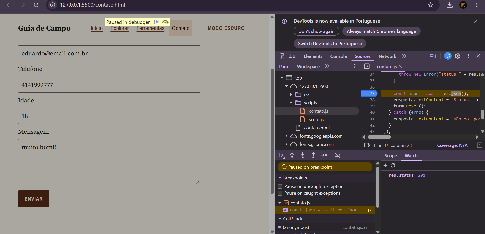
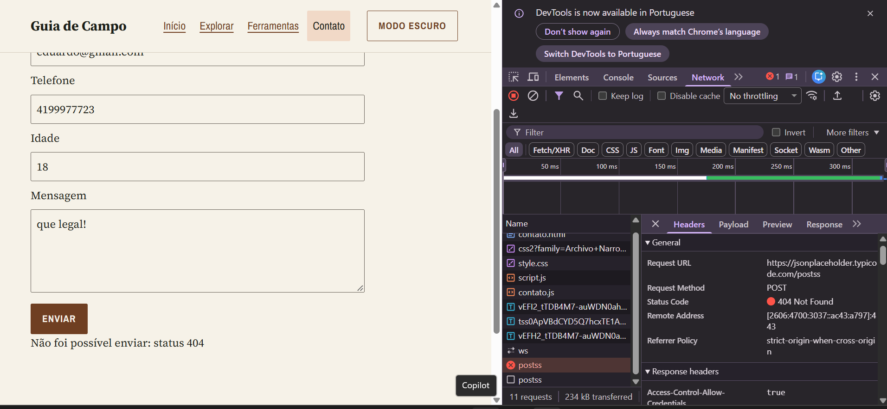

# Guia de Campo Pokémon

## 1. Nome do projeto e tema

**Nome do projeto:** Guia de Campo Pokémon\
**Tema:** Pokédex digital apresentada como um guia de campo naturalista.

O projeto é uma aplicação web que permite explorar espécies de Pokémon e
consultar informações como número, nome, tipo, peso, altura e imagem
oficial. O site apresenta os Pokémon como espécies registradas em um guia de campo,
reunindo suas principais informações em cartões. A página Explorar permite buscar
pelo nome e filtrar por tags de tipo, categoria (lendário, mítico e bebê) e geração.

Além da consulta às espécies, o site oferece gerenciamento de favoritos,
ferramentas para cálculos e estatísticas, formulário de contato e
alternância entre modo claro e escuro.

## 2. Integrantes e responsabilidades

| Integrante                        | Responsabilidades                                                                                                                                    |
| --------------------------------- | ---------------------------------------------------------------------------------------------------------------------------------------------------- |
| **Emily Maria Luciani**           | Estrutura base do site, criação dos quatro arquivos HTML, página inicial, estrutura visual compartilhada, modo escuro e organização do README final. |
| **José Eduardo Bernardi Marques** | Página Explorar, integração GET com a PokéAPI, carregamento dos Pokémon, criação dos cartões, busca em tempo real e tags de filtro.                  |
| **Erika Yumi Kanashiro**          | Sistema de favoritos integrado ao `localStorage`, página Ferramentas, calculadora, médias de peso e altura e filtro de Pokémon por peso.             |
| **Eduardo Elias Lopes**           | Página Contato, formulário, integração POST, validação dos campos e relatório de debugging do TDE 02.                                                |

## 3. APIs utilizadas

### 3.1 PokéAPI --- consulta de Pokémon

**Documentação oficial:** https://pokeapi.co/docs/v2\
**Método HTTP:** `GET`\
**Finalidade:** obter a lista de Pokémon e os dados individuais
utilizados nos cartões da página Explorar.

O projeto começa consultando uma lista de 50 Pokémon. A resposta contém os
nomes e as URLs dos registros individuais. Depois, o sistema consulta cada
URL para buscar os dados completos e montar os cartões da página Explorar.

---

Endpoint Método Utilização

---

`https://pokeapi.co/api/v2/pokemon?limit=50` GET Retorna a lista inicial
de 50 Pokémon e as URLs
para consultar os
detalhes de cada
espécie.

`https://pokeapi.co/api/v2/pokemon/{id-ou-nome}` GET Retorna os dados
individuais de um
Pokémon, incluindo
identificador, nome,
tipos, peso, altura e
sprites. A aplicação
utiliza a URL
individual retornada
pelo primeiro endpoint.

---

**Tags de filtro da página Explorar.** As tags se combinam com a busca por
nome (só passa quem atende a todos os filtros):

- **Tipo:** até 2 tags, e o Pokémon precisa ter todos os tipos marcados
  (Fogo + Voador mostra o Charizard). A lista vem de
  `https://pokeapi.co/api/v2/type/{nome}` (GET) e fica guardada depois da
  primeira consulta, então marcar o mesmo tipo de novo não chama a API.
- **Categoria:** Lendário, Mítico e Bebê (vale estar em qualquer uma das
  marcadas). A PokéAPI não tem uma lista pronta dessas categorias: elas só
  aparecem nos campos `is_legendary`, `is_mythical` e `is_baby` de cada
  espécie (`/pokemon-species/{id}`), o que seriam 1.025 chamadas. Por isso
  os números dessas espécies foram copiados desses campos uma única vez, em
  17/11/2026, para as constantes `CATEGORIAS` do `scripts/explorar.js`. Se a
  API ganhar espécies novas, essas listas precisam ser atualizadas.
- **Geração:** escolha única, de I (Kanto) a IX (Paldea). Cada geração é uma
  faixa seguida de números (a Geração I vai de 1 a 151), guardada na constante
  `GERACOES`.
- Categoria e geração valem para espécies. As formas alternativas (Mega,
  Gigantamax e regionais, com número acima de 10000) só aparecem na busca por
  nome ou pelo filtro de tipo.

**Arquivo responsável:** `scripts/explorar.js`

### 3.2 JSONPlaceholder --- envio de contato

**Documentação:** https://jsonplaceholder.typicode.com/\
**Endpoint previsto no enunciado:**
`https://jsonplaceholder.typicode.com/posts`\
**Método HTTP:** `POST`\
**Finalidade:** simular o envio dos dados preenchidos no formulário de
contato.

A requisição deve enviar os dados do formulário em JSON, utilizando o
cabeçalho `Content-Type: application/json` e `JSON.stringify()` no corpo
da requisição. A resposta esperada para a criação simulada é o status
HTTP `201`.

**Arquivo para a integração:** `scripts/contato.js`

---

# TDE 01 --- Documentação das funções

Nesta seção estão documentadas as funções desenvolvidas por Erika Yumi
Kanashiro para o sistema de favoritos e para a página Ferramentas. Cada
função apresenta seus parâmetros, o retorno e onde é utilizada.

### Arquivo: `scripts/script.js`

#### `lerFavoritos()`

- **Recebe:** nenhum parâmetro.
- **Retorna:** um array com os Pokémon salvos como favoritos. Caso não
  existam dados válidos ou ocorra um erro na leitura, retorna um array
  vazio.
- **Utilização:** é chamada pelas demais funções de favoritos e pela
  página Ferramentas para recuperar os dados armazenados.
- **Funcionamento:** acessa o `localStorage` pela chave `"favoritos"`,
  converte o conteúdo JSON com `JSON.parse()` e verifica se o
  resultado é um array.

#### `salvarFavoritos(lista)`

- **Recebe:** `lista`, um array contendo os objetos dos Pokémon
  favoritos.
- **Retorna:** não possui retorno explícito.
- **Utilização:** é chamada por `alternarFavorito()` depois que a
  lista é modificada.
- **Funcionamento:** converte o array em JSON com `JSON.stringify()` e
  salva o conteúdo no `localStorage`, utilizando a chave
  `"favoritos"`.

#### `alternarFavorito(pokemon)`

- **Recebe:** `pokemon`, um objeto com os dados da espécie: `id`,
  `nome`, `tipo`, `peso`, `altura` e `imagem`.
- **Retorna:** o array atualizado de favoritos.
- **Utilização:** é chamada pelo botão de favorito dos cartões criados
  na página Explorar.
- **Funcionamento:** recupera a lista com `lerFavoritos()` e procura o
  Pokémon pelo identificador usando `findIndex()`. Se já estiver
  salvo, remove o item com `splice()`. Caso contrário, adiciona o
  objeto completo com `push()`. Por fim, salva a lista atualizada com
  `salvarFavoritos()`.

#### `ehFavorito(id)`

- **Recebe:** `id`, identificador numérico do Pokémon.
- **Retorna:** `true` se o Pokémon estiver na lista de favoritos ou
  `false` caso não esteja.
- **Utilização:** é chamada na página Explorar para definir o estado
  visual do botão de favorito de cada cartão.
- **Funcionamento:** recupera os favoritos e utiliza `find()` para
  verificar se existe um Pokémon com o identificador informado.

### Arquivo: `scripts/ferramentas.js`

#### `somar(a, b)`

- **Recebe:** `a` e `b`, os dois números da operação.
- **Retorna:** a soma dos valores (`a + b`).
- **Utilização:** é passada como callback para `calcular()` quando a
  opção de adição é selecionada na calculadora.

#### `subtrair(a, b)`

- **Recebe:** `a` e `b`, os dois números da operação.
- **Retorna:** a diferença entre os valores (`a - b`).
- **Utilização:** é passada como callback para `calcular()` quando a
  opção de subtração é selecionada na calculadora.

#### `multiplicar(a, b)`

- **Recebe:** `a` e `b`, os dois números da operação.
- **Retorna:** o produto dos valores (`a * b`).
- **Utilização:** é passada como callback para `calcular()` quando a
  opção de multiplicação é selecionada na calculadora.

#### `dividir(a, b)`

- **Recebe:** `a` e `b`, sendo `a` o dividendo e `b` o divisor.
- **Retorna:** o resultado da divisão. Se `b` for zero, retorna uma
  mensagem informando que não é possível dividir por zero.
- **Utilização:** é passada como callback para `calcular()` quando a
  opção de divisão é selecionada na calculadora.
- **Validação:** impede que a operação retorne `Infinity` em uma
  divisão por zero.

#### `calcular(a, b, operacao)`

- **Recebe:** `a` e `b`, os números da operação, e `operacao`, uma
  função recebida como callback.
- **Retorna:** o resultado devolvido pela função de operação.
- **Utilização:** é chamada pelo evento de clique do botão Calcular.
- **Funcionamento:** executa a função recebida, passando `a` e `b`
  como argumentos. Dessa forma, a mesma função pode executar as quatro
  operações matemáticas.

#### Função anônima do evento do botão Calcular

- **Recebe:** o evento de clique, disponibilizado automaticamente pelo
  `addEventListener()` (não é utilizado diretamente no corpo da
  função).
- **Retorna:** não possui retorno explícito.
- **Utilização:** é executada quando o usuário clica no botão
  `#btn-calcular`.
- **Funcionamento:** verifica se os dois campos foram preenchidos,
  converte os valores para números, valida os dados, identifica a
  operação escolhida, chama `calcular()` e apresenta o resultado ou a
  mensagem de erro no elemento `#resultado-calculo`.

#### `formatarPeso(peso)`

- **Recebe:** `peso`, valor de peso fornecido pela PokéAPI em
  hectogramas.
- **Retorna:** uma string com o peso convertido para quilogramas, com
  uma casa decimal e vírgula como separador decimal.
- **Utilização:** é chamada na apresentação das médias e dos dados de
  cada Pokémon favorito.
- **Funcionamento:** divide o valor por 10 e acrescenta a unidade
  `kg`.

#### `formatarAltura(altura)`

- **Recebe:** `altura`, valor de altura fornecido pela PokéAPI em
  decímetros.
- **Retorna:** uma string com a altura convertida para metros, com uma
  casa decimal e vírgula como separador decimal.
- **Utilização:** é chamada na apresentação das médias e dos dados de
  cada Pokémon favorito.
- **Funcionamento:** divide o valor por 10 e acrescenta a unidade `m`.

#### `formatarNome(nome)`

- **Recebe:** `nome`, nome do Pokémon em texto.
- **Retorna:** o nome com a primeira letra em maiúscula. Se o valor
  não estiver informado, retorna `"Nome não informado"`.
- **Utilização:** é chamada ao montar os cartões da lista de favoritos
  e o texto alternativo das imagens.

#### `atualizarMedias()`

- **Recebe:** nenhum parâmetro.
- **Retorna:** não possui retorno explícito; atualiza os elementos
  HTML das médias.
- **Utilização:** é executada quando a página Ferramentas é carregada.
- **Funcionamento:** recupera os favoritos, soma os pesos e as alturas
  usando `reduce()`, divide cada total pela quantidade de Pokémon e
  apresenta as médias convertidas para quilogramas e metros. Quando
  não há favoritos, apresenta um traço no lugar dos valores.

#### `mostrarFavoritos(favoritos)`

- **Recebe:** `favoritos`, array de objetos de Pokémon que devem ser
  exibidos.
- **Retorna:** não possui retorno explícito; atualiza a lista de
  favoritos no HTML.
- **Utilização:** é chamada por `mostrarTodos()` e `filtrarPorPeso()`.
- **Funcionamento:** limpa a lista anterior, atualiza o contador e
  cria elementos HTML para cada Pokémon. Utiliza `createElement()` e
  `textContent` para inserir os dados. Quando a lista está vazia,
  exibe uma mensagem informativa.

#### `mostrarTodos`

- **Tipo:** função arrow.
- **Recebe:** nenhum parâmetro.
- **Retorna:** não possui retorno explícito.
- **Utilização:** é executada pelo botão `#btn-todos`.
- **Funcionamento:** recupera todos os favoritos, chama
  `mostrarFavoritos()` e atualiza o estado dos botões de filtro com
  `aria-pressed`.

#### `filtrarPorPeso`

- **Tipo:** função arrow.
- **Recebe:** nenhum parâmetro.
- **Retorna:** não possui retorno explícito.
- **Utilização:** é executada pelo botão `#btn-filtro`.
- **Funcionamento:** recupera os favoritos e utiliza `filter()` para
  selecionar somente os Pokémon com peso superior a 10 kg. Como a
  PokéAPI fornece o peso em hectogramas, a condição utilizada é
  `pokemon.peso > 100`. Depois, exibe o resultado com
  `mostrarFavoritos()` e atualiza o estado dos botões.

### Conceitos de JavaScript exigidos no TDE 01

- **`JSON.parse()` e `JSON.stringify()`:** leitura e gravação dos
  favoritos no formato JSON.
- **`find()` e `findIndex()`:** procura de Pokémon na lista de
  favoritos.
- **`push()` e `splice()`:** inclusão e remoção de Pokémon no array.
- **`reduce()`:** cálculo das somas utilizadas nas médias de peso e
  altura.
- **`filter()`:** seleção dos Pokémon com peso superior a 10 kg.
- **Callback:** a função `calcular()` recebe a função da operação
  matemática como argumento.
- **Funções arrow:** utilizadas em `mostrarTodos` e `filtrarPorPeso`,
  além dos callbacks dos métodos de array.
- **Função anônima:** utilizada no `addEventListener()` do botão da
  calculadora.
- **Manipulação do DOM:** criação e atualização dos elementos HTML
  para exibir os favoritos e os resultados.
- **Eventos:** utilização de `addEventListener()` para responder aos
  cliques nos botões.
- **`localStorage`:** persistência da lista de favoritos no navegador.

### Formato do objeto salvo nos favoritos

O objeto completo do Pokémon é armazenado para que a página Ferramentas
possa utilizar os dados sem realizar uma nova consulta à API.

```javascript
{
  id: 25,
  nome: "pikachu",
  tipo: "electric",
  peso: 60,
  altura: 4,
  imagem: "https://..."
}
```

Os cartões da página Explorar também criam o campo `tipos` (por exemplo,
`["fire", "flying"]`), com todos os tipos do Pokémon, que é salvo junto no
favorito. O campo `tipo` continua sendo só o primeiro tipo, e a página
Ferramentas não depende do `tipos`.

A chave utilizada no `localStorage` é `"favoritos"`.

---

# TDE 02 --- Relatório de debugging

Erros reais encontrados durante o desenvolvimento e a integração do projeto.

### Erro 1: site sem CSS e sem JS no GitHub Pages

- **Sintoma:** no GitHub Pages as páginas abriam sem estilo e sem o modo escuro.
- **Ferramenta:** DevTools, aba Network (o `style.css` e os `.js` voltavam com status 404).
- **Causa:** os caminhos começavam com `/`, então o navegador procurava os arquivos na
  raiz do domínio (`usuario.github.io/css/...`) e não na pasta do projeto.
- **Solução:** trocar para caminhos relativos nos 4 HTML (commit `c42d163`).

```html
<!-- antes -->
<link rel="stylesheet" href="/css/style.css">
<script src="/scripts/script.js" defer></script>

<!-- depois -->
<link rel="stylesheet" href="css/style.css">
<script src="scripts/script.js" defer></script>
```

### Erro 2: mensagem de erro sem cor no modo claro

- **Sintoma:** a mensagem de erro da página Explorar não ficava com a cor de erro no modo claro.
- **Ferramenta:** DevTools, aba Elements > Computed (a variável `--color-error` aparecia sem valor).
- **Causa:** a variável `--color-error` só era definida dentro da classe `.escuro`.
- **Solução:** definir a variável também no `:root` (commit `8d02521`).

```css
/* antes: --color-error existia só no .escuro */
.mensagem-erro.explorar__erro { color: var(--color-error, #9B411E); }

/* depois: definida no :root */
:root {
  --color-error: #9B411E;
}
.mensagem-erro.explorar__erro { color: var(--color-error); }
```

### Erro 3: campo inválido sem borda de erro no Contato

- **Sintoma:** ao sair de um campo vazio, o JavaScript colocava a classe `.erro`, mas a
  borda não mudava de cor.
- **Ferramenta:** DevTools, aba Elements > Styles (a regra `.erro` aparecia riscada).
- **Causa:** especificidade. A regra `.contato input` (0,1,1) é mais forte que `.erro`
  (0,1,0), então a cor da borda de `.contato input` vencia.
- **Solução:** deixar o seletor mais específico com `.contato .erro` (0,2,0).

```css
/* antes */
.erro {
  border-color: var(--color-error);
}

/* depois */
.contato .erro {
  border-color: var(--color-error);
}
```

### Erro 4 (lógica): PREENCHER

- **Sintoma:**
- **Ferramenta:**
- **Causa:**
- **Solução:**

```js
// antes

// depois
```

### Print do breakpoint (Scope/Watch)

Breakpoint na linha `const json = await res.json();` do `scripts/contato.js`, com
`res.status` no Watch mostrando 201.



### Print do erro investigado na aba Network

URL do POST trocada de propósito para `/postss`: a aba Network mostrou o status 404 e a
página exibiu a mensagem de erro. Depois a URL voltou para `/posts`.



---

## Estrutura de arquivos do projeto

```text
Projeto-Final-Front-End/
│
├── index.html
├── explorar.html
├── ferramentas.html
├── contato.html
│
├── css/
│   └── style.cs
│
└── scripts/
    ├── script.js
    ├── explorar.js
    ├── ferramentas.js
    └── contato.js
```

**Projeto Final de Front-End --- RA 3.**
